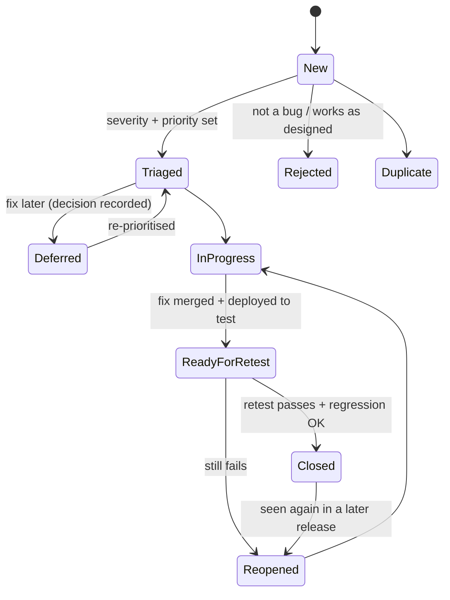
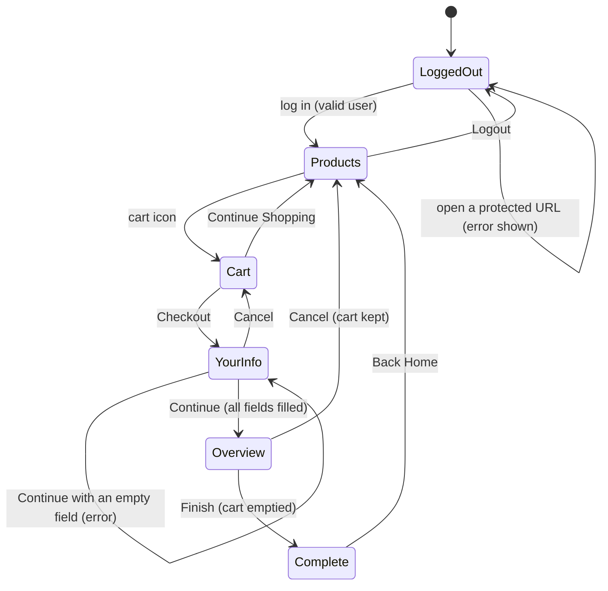

# P01: QE Fundamentals: What to Test and Why

> **Goal:** decide *what* is worth testing before you automate anything. Learn how testing fits into delivery (SDLC/STLC), the bug life cycle, the core test-design techniques, test cases and traceability, reviewing stories before code exists, and using AI as a test-design partner.
> **Apps:** Toolshop (registration, checkout, favourites), SauceDemo (checkout flow). The 🟢 tasks need no code: you write Markdown and explore the apps by hand. **Prerequisites:** P00-00. **Time:** ~17 h.
> **Why before Python?** Junior interviews start here, and so does every good automated test. Automating the wrong checks faster helps nobody.

| ID | Task | Level | Time |
|---|---|---|---|
| P01-01 | QA in the SDLC: levels, types, life cycles and the test pyramid | 🟢 | 4h |
| P01-02 | Test-design techniques: partitions, boundaries, decision tables, states and pairs | 🟢 | 4h |
| P01-03 | Test scenarios, test cases and traceability | 🟢 | 3h |
| P01-04 | Story review, risk analysis and shift-left | 🔵 | 3h |
| P01-05 | LLM fundamentals and prompting for QA | 🟢 | 3h |

---

### P01-01 · QA in the SDLC: levels, types, life cycles and the test pyramid

**Level:** 🟢 Zero · **Time:** 4h · **App:** Toolshop, SauceDemo · **Deliverable:** `docs/fundamentals/qa-in-sdlc.md`, `docs/fundamentals/glossary.md`

#### 📋 Task
1. Draw how one feature travels through a Scrum team (refinement → development → PR and CI → testing → release → production monitoring) as a Mermaid diagram in `qa-in-sdlc.md`. Mark what a QE does at **each** step, not only at "testing".
2. For Toolshop, write one concrete example check for each **test level** (unit, integration/API, system/end-to-end, acceptance) and each **test type** (functional, smoke, sanity, regression, retest, exploratory, performance, security, accessibility, usability, compatibility).
3. Draw the **bug life cycle** you'd use in a team, including Rejected, Duplicate, Deferred and Reopened.
4. Classify these six issues by **severity** and **priority**, with one line of reasoning each:
   1. The Toolshop logo on the home page is misspelled.
   2. Checkout crashes when paying with *Buy Now Pay Later* in 12 instalments.
   3. SauceDemo lets you check out with an empty cart and shows *Total: $0.00*.
   4. Toolshop registration rejects customers on their 18th birthday.
   5. An admin-only report crashes for invoices older than two years (a CSV export works as a workaround).
   6. A typo in the legal terms changes "not liable" to "liable".
5. Write a glossary of at least 25 testing terms in your own words (start with the terms in the Concepts list).

**Done when**
- [ ] Both documents exist, in your words, with the diagram
- [ ] All six issues have a severity, a priority and a reason, including one "low severity, high priority" and one "high severity, low priority"
- [ ] You can answer every [Z] question below out loud in under 2 minutes each

#### 📘 User guide

**Concepts**
- **SDLC:** the software development life cycle, how a product goes from idea to production (in most teams, iterative: Scrum or Kanban).
- **STLC:** the software testing life cycle: requirement analysis → test planning → test design → environment and data setup → execution → closure (report and lessons learned). In agile teams these phases shrink and repeat every sprint.
- **Test levels:** *unit* (one function or class), *integration* (components together, often via API), *system/end-to-end* (the whole app like a user), *acceptance* (does it meet the business need?).
- **Test types:** *functional* (what it does) and *non-functional* (how well: performance, security, accessibility, usability, compatibility). Also *smoke* (is the build testable at all?), *sanity* (does this one fix or area work?), *regression* (did anything that used to work break?), *retest* (is this specific bug fixed?).
- **Verification vs validation:** *verification* asks "did we build it right?" (against the spec); *validation* asks "did we build the right thing?" (for the user).
- **Error → defect → failure:** a person makes an *error*, which leaves a *defect* (bug) in the code, which may cause a *failure* when that code runs.
- **Severity vs priority:** *severity* is the impact on the system or user; *priority* is how soon the business wants it fixed. They're set by different people for different reasons.
- **Black-box / white-box / grey-box:** testing from the outside with no code knowledge, testing with full knowledge of the code, or a mix (e.g. API tests informed by the DB schema).
- **Test pyramid:** many fast unit tests, fewer API/integration tests, and few slow UI tests.
- **Shift-left / shift-right:** test earlier (reviews, unit, API, in CI) and learn from production (monitoring, feature flags, canary releases).

**Deep dive**

**Testing reduces risk; it can't prove there are no bugs.** The seven classic testing principles are worth knowing by name, because interviewers ask:
1. Testing shows the *presence* of defects, not their absence.
2. Exhaustive testing is impossible, so we choose, using risk and techniques (P01-02).
3. Early testing saves time and money: a question in refinement is cheaper than a bug in production.
4. Defects cluster: a few modules contain most bugs, so look harder where you've already found some.
5. The pesticide paradox: re-running the same tests finds fewer new bugs, so keep refreshing tests and exploring.
6. Testing is context-dependent: a bank's release process isn't a game studio's.
7. The absence-of-errors fallacy: a bug-free product that solves the wrong problem is still a failure (validation).

**Where a QE adds value across the cycle:** in refinement (questions, testable acceptance criteria, risks: P01-04); during development (pairing, unit-test review, API tests early); in the PR (review test code, CI gates: P09); before release (exploratory testing, regression, go/no-go); after release (monitoring, incident analysis, adding the missing test). A QE who only appears at the "testing" column is a bottleneck by design.

**The test pyramid, and why it's shaped that way.** Unit tests run in milliseconds and pinpoint the broken line. API tests are fast and cover business rules without a browser. UI tests prove user journeys but are slow, need a full environment and break for reasons unrelated to the feature. The anti-pattern is the **ice-cream cone**: mostly manual and UI tests, few unit tests. It's slow, flaky and expensive. The pyramid is a guide, not a law: the "testing trophy" variant weights integration tests most heavily, and some products (a UI-heavy design system) legitimately need more UI checks. What matters is putting each check at the *lowest layer that can catch the bug*.

**Severity and priority disagree more than you'd think.** A misspelled logo is trivial technically (low severity) but embarrassing on the home page (high priority). A crash in an admin report used twice a year with a workaround is severe (high severity) but can wait (low priority). QE usually proposes severity; product decides priority, with QE's evidence.

**Examples**

🟢 **Low: test levels and types, made concrete for Toolshop**

| Level or type | Example check on Toolshop |
|---|---|
| Unit | A `cart_total()` function adds line totals and rounds to 2 decimals |
| Integration / API | `POST /carts/{id}` with a product ID returns the cart with that product |
| System / E2E | A customer logs in, adds a hammer, pays by bank transfer and sees an invoice |
| Acceptance | "As a customer I can pay with a gift card": the product owner agrees the flow meets the story |
| Smoke | The home page, login and the product API respond after every deployment |
| Sanity | After the "sort by price" fix, sorting works on the home page and in search results |
| Regression | The full checkout suite still passes after the payment-provider upgrade |
| Retest | The bug "rejects customers on their 18th birthday" no longer reproduces |
| Exploratory | A 60-minute session on the checkout with a charter (P10-01) |
| Non-functional | Search responds in under 1 s at 20 users (P11-01); checkout is keyboard-accessible (P11-02) |

🔵 **Medium: the bug life cycle as a diagram**

Two details interviewers look for: a bug is **closed by the tester after a retest**, not by the developer who fixed it; and *Rejected* or *Deferred* always carries a written reason.

🟣 **High/Complex: apply the pyramid to one feature**

Feature: *"Customers can pay with a gift card; any remaining balance goes to a second payment method."*

| Risk | Lowest layer that catches it | Checks (count) |
|---|---|---|
| Balance maths and rounding (partial payment, currency) | Unit | 12 parametrised cases (P03-03 style) |
| Card validation: expired, used up, wrong PIN, wrong currency | API | 8 negative tests |
| Same card used twice at the same moment | API | 2 concurrency tests (P07) |
| Order and payment rows consistent after checkout | API + DB | 3 tests (P06-04) |
| The user can actually complete the split payment | UI (E2E) | **1** happy-path journey + 1 error message |
| Screen readers announce the remaining balance | UI + manual | 1 axe scan + a manual check (P11-02) |
| Fraud patterns in production | Monitoring (shift-right) | Alert on unusual gift-card redemptions |

Twenty-something checks, and only two drive a browser. That ratio *is* the pyramid, justified by risk rather than drawn from habit.

<details><summary><b>Model answer for step 4 (compare only after writing yours)</b></summary>

| # | Severity | Priority | Why |
|---|---|---|---|
| 1 Misspelled logo | Low | **High** | No functional impact, but every visitor sees it and it damages the brand |
| 2 BNPL 12 instalments crash | **High** | Medium–High | Blocks payment; priority depends on how many customers use that option (check the analytics) |
| 3 Empty-cart checkout | Medium | Low–Medium | An invalid state transition (P01-02); harmless at $0 on a demo, risky if it creates empty orders downstream |
| 4 Rejected on 18th birthday | Medium | Medium | An off-by-one at a legal boundary; affects few people per day but it's a compliance question, so involve product |
| 5 Old-invoice report crash | **High** | **Low** | A crash, but admin-only, rare, with a workaround |
| 6 Legal typo reverses meaning | Low (technically) | **Highest** | One word, but a legal risk: fix before the next release |
</details>

#### 🎤 Interview Q&A

<details><summary><b>[Z] What's the difference between verification and validation?</b></summary>

Verification checks that we built the product *right*, against the specification: reviews, static analysis, tests against acceptance criteria. Validation checks that we built the *right product* for the user's real need: demos, user acceptance testing, usability testing, production feedback. You can pass verification perfectly and still fail validation if the spec was wrong.
</details>

<details><summary><b>[Z] What are the phases of the STLC?</b></summary>

Requirement analysis (what to test, testability questions), test planning (scope, approach, resources, risks, entry/exit criteria), test design (scenarios, cases, data), environment and data setup, test execution (run, log defects, retest, regression) and test closure (report, metrics, lessons learned). In agile teams the same phases happen in small loops inside every sprint rather than as one long sequence.
</details>

<details><summary><b>[Z] Severity vs priority: explain with an example of each combination.</b></summary>

Severity is the technical or user impact; priority is how urgently the business wants a fix. High severity, low priority: a crash in a rarely used admin report with a workaround. Low severity, high priority: a misspelled company name on the home page. High/high: checkout fails for all card payments. Low/low: a slightly misaligned icon in the footer.
</details>

<details><summary><b>[Z] Walk me through the bug life cycle.</b></summary>

New → triaged (severity and priority set, assigned) → in progress → fixed and deployed to a test environment → ready for retest → the tester retests and runs related regression → closed, or reopened if it still fails. Side exits: rejected (works as designed, with a reason), duplicate (linked to the original), deferred (a recorded decision to fix later). The tester, not the developer, closes the bug.
</details>

<details><summary><b>[Z] Error, defect and failure: what's the difference?</b></summary>

An error is a human mistake (misreading a requirement). It can introduce a defect, a flaw in the code or configuration. When that defective code runs under certain conditions, it produces a failure: behaviour that differs from what's expected. Not every defect causes a failure (dead code), and failures can also come from the environment.
</details>

<details><summary><b>[Z] Smoke testing vs sanity testing?</b></summary>

Smoke testing is a broad, shallow check that a new build is stable enough to test at all: the app starts, login works, key pages load. Sanity testing is a narrow, focused check that a specific fix or change works and hasn't obviously broken its surroundings. Smoke answers "can we test this build?"; sanity answers "does this change look right?".
</details>

<details><summary><b>[Z] Regression testing vs retesting?</b></summary>

Retesting (confirmation testing) runs the exact steps of a fixed bug to confirm the fix. Regression testing checks that *other*, previously working functionality still works after a change. Retesting is targeted and planned per bug; regression is broad and is the main candidate for automation.
</details>

<details><summary><b>[Z] Black-box, white-box and grey-box testing?</b></summary>

Black-box: test from the outside against requirements, without looking at code (most UI and API testing). White-box: design tests from the code's structure, e.g. branches and paths (mostly unit tests). Grey-box: partial knowledge, such as using the database schema or API contract to design better API tests. SDETs usually work grey-box.
</details>

<details><summary><b>[Z] What are the test levels?</b></summary>

Unit (a single function or class, in isolation), integration (how components work together, often through APIs, databases or queues), system or end-to-end (the complete application as a user experiences it) and acceptance (whether it meets the business need, often with the product owner or users). Each level catches different bugs at a different cost.
</details>

<details><summary><b>[Z] What is the test pyramid, and why?</b></summary>

Many fast, isolated unit tests at the base, fewer service/API tests in the middle, and few end-to-end UI tests on top. Lower layers are faster, cheaper, more stable and pinpoint failures, while upper layers prove integration and the user's view. The anti-pattern is the "ice-cream cone" (mostly UI and manual), which is slow and flaky.
</details>

<details><summary><b>[Z] Name the seven testing principles.</b></summary>

Testing shows the presence of defects, not their absence; exhaustive testing is impossible; early testing saves time and money; defects cluster; the pesticide paradox (repeated tests stop finding new bugs); testing is context-dependent; and the absence-of-errors fallacy (a bug-free product can still be the wrong product).
</details>

<details><summary><b>[H] Functional vs non-functional testing: which non-functional types would you consider for an online shop?</b></summary>

Functional testing checks *what* the system does (rules, flows, data); non-functional checks *how well* it does it. For a shop: performance (search and checkout under peak load), security (authentication, authorisation, payment data), accessibility (keyboard and screen-reader checkout, often a legal requirement), compatibility (browsers and mobile), and reliability (what happens when the payment provider times out). P11 covers the first three hands-on.
</details>

<details><summary><b>[SH] A manager says "QA is our bottleneck". What do you change?</b></summary>

First measure where time is actually lost (waiting for environments, late handovers, manual regression, flaky suites). Then shift testing left and spread it: testable acceptance criteria in refinement, developers owning unit tests, API tests written alongside the feature, fast CI gates, automated regression, risk-based test depth, and exploratory testing on each story as it's built rather than at the end. QE moves from "the stage everything waits for" to coaching and enabling quality across the team.
</details>

#### 🤖 AI assist
- Ask AI to quiz you: *"Give me 10 short scenarios; for each I'll name the test level and type."* Argue with its answers where you disagree; the arguing is the learning.
- Paste your glossary and ask for terms that are wrong or vague. Check every correction against a second source (e.g. the ISTQB glossary).

---

### P01-02 · Test-design techniques: partitions, boundaries, decision tables, states and pairs

**Level:** 🟢 Zero · **Time:** 4h · **App:** Toolshop registration, SauceDemo checkout · **Deliverable:** `docs/test-design/registration.md`, `docs/test-design/checkout-states.md`

#### 📋 Task
1. **Toolshop registration** (https://practicesoftwaretesting.com/auth/register): using the rules in the deep dive, write **equivalence partitions** and **boundary values** for *age* (from date of birth), *password length* and *first-name length*.
2. Build a **decision table** for the five password rules, then collapse it to the smallest set of tests that still exercises every rule.
3. **Try your boundary values against the real app**, in the UI or in Swagger. Do the real boundaries match the rules? Record every mismatch as a candidate bug: what you tried, what you expected, what happened.
4. **SauceDemo checkout:** draw a **state-transition diagram** (logged out → products → cart → your information → overview → complete), with every button and direct URL as a transition. Derive tests for every valid transition and at least three *invalid* ones.
5. **Pairwise:** SauceDemo has 5 usable users × 4 sort orders × 3 browsers = 60 combinations. Reduce them to an all-pairs set (by hand, or with the 🟣 example after P02).

**Done when**
- [ ] Every technique has a table or diagram, the tests it produced, and the count before and after reduction
- [ ] You tried your boundaries against the real app and recorded at least one mismatch (at the time of writing there were several)
- [ ] You can explain why boundary testing checks values *on* and *either side of* each boundary

#### 📘 User guide

**Concepts**
- **Equivalence partitioning (EP):** split inputs into groups the system should treat the same way; test one value per group. Include *invalid* partitions (empty, too long, wrong type).
- **Boundary value analysis (BVA):** bugs cluster at the edges of partitions (`>` vs `>=`), so test the boundary and its neighbours. *2-value BVA* tests the boundary and the value just outside; *3-value BVA* adds the value just inside.
- **Decision table:** a table of conditions (inputs or rules) × actions (outcomes), for logic where *combinations* matter. "–" means "doesn't matter", which is how you collapse rules.
- **State-transition testing:** model the system as states, events that move between them, and guards. Test valid transitions *and* invalid ones (events that should be refused in a given state).
- **Pairwise (all-pairs) testing:** choose combinations so every *pair* of parameter values appears at least once. It's far fewer tests than every combination.
- **Error guessing:** experience-based ideas: empty input, spaces, very long text, emoji, leap days, time zones, double clicks, the back button.

**Deep dive**

**The registration rules, straight from the API.** Sending invalid data to Toolshop's `POST /users/register` returns its own validation messages, which is a useful way to discover rules when there's no spec:
- first name: required, at most **40** characters
- date of birth: "Customer must be **18** years old" and "Customer must be younger than **75** years old"
- password: at least **8** characters, at least one **upper and one lower** case letter, at least one **number**, at least one **symbol**, and it must **not appear in a known data leak** (that fifth rule only shows up once the other four pass)

**Spec vs implementation: what we found on 2026-09-23.** Probing the boundaries through the API (without creating users) showed:
- a customer whose **18th birthday is today** was *rejected*, although by the message they're 18 (a likely off-by-one or time-zone bug);
- a customer born in **1934**, who is 92, was *accepted*, although the message says "younger than 75". The real upper limit sat somewhere in 1933, far from 75 years ago;
- `not-an-email` was accepted as an email address by the API.

The app may have changed since, so **verify yourself** rather than copying these findings. The lesson doesn't change: a boundary lives where the *code* puts it, not where the message says. Only testing the edges tells you which.

**Age boundaries move every day.** "18 years old" is relative to *today*, so the boundary dates change daily, and leap days (born 29 February) and the server's time zone make it harder. Tests must compute dates from "today" rather than hard-code them. You'll write that in Python in P02-02.

**Decision tables stop you missing combinations.** Five yes/no password rules give 2⁵ = 32 combinations. Because the rules are *independent* (each produces its own message), you need all-valid plus one test per broken rule: 6 tests, plus one "everything wrong" test to check that all messages appear together. When rules *interact* (a discount only if the customer is a member **and** the basket is over €100 **and** it's not a sale item), collapsing needs more care, and that's when decision tables earn their keep.

**Invalid transitions are where bugs hide.** Most people test the happy path through a flow. The interesting questions are "what happens if I do *this* here?": open the overview page directly, press the browser's back button after paying, check out with an empty cart. On SauceDemo the last one leads to an overview showing *Total: $0.00*. Is that a bug? It's an invalid transition the app allows, so raise it and let product decide.

**Why pairwise works:** studies of real failures (NIST, Kuhn et al.) found most were triggered by a single parameter value or by an interaction between two. Covering every pair finds most combination bugs at a fraction of the cost. It isn't enough when three-way interactions matter (safety-critical systems, pricing engines), and it doesn't replace thinking about which *values* to use. EP and BVA choose the values, then pairwise combines them.

**Examples**

🟢 **Low: partitions and boundaries for registration**

| Field | Partition | Valid? | Test values |
|---|---|---|---|
| First name length | 0 (empty) | ❌ "required" | `""` |
| | 1–40 | ✅ | 1 char, 40 chars |
| | 41+ | ❌ "not greater than 40" | 41 chars |
| Password length | 0–7 | ❌ | 7 chars (e.g. `Ab1!xyz`) |
| | 8+ | ✅ (if the other rules pass) | 8 chars, 64 chars |
| Age (from date of birth) | under 18 | ❌ | 18th birthday is **tomorrow** |
| | 18 to under 75 | ✅ | 18th birthday is **today**, 18 + 1 day, 75th birthday is tomorrow |
| | 75 and over | ❌ | 75th birthday is **today**, 75 + 1 day, 100 years |
| Date of birth format | not a date | ❌ | `31-02-2000`, `2000-02-30`, `hello` |

🔵 **Medium: a decision table for the password rules, collapsed**

| Rule → | R1 | R2 | R3 | R4 | R5 | R6 | R7 |
|---|---|---|---|---|---|---|---|
| C1 length ≥ 8 | Y | **N** | Y | Y | Y | Y | N |
| C2 upper + lower | Y | – | **N** | Y | Y | Y | N |
| C3 has a number | Y | – | – | **N** | Y | Y | N |
| C4 has a symbol | Y | – | – | – | **N** | Y | N |
| C5 not leaked | Y | – | – | – | – | **N** | – |
| **Expected** | accepted | "at least 8" | "upper and lower" | "number" | "symbol" | "data leak" | all four messages |
| **Example** | *a random strong one* | `Ab1!xyz` | `abcdef1!` | `Abcdefg!` | `Abcdefg1` | `Password1!` | `abc` |

Thirty-two combinations become seven tests, and every rule is proven to fire on its own. R7 checks how the app reports several errors at once, which is a real usability question.

🟣 **High/Complex: model the SauceDemo checkout, then generate pairwise sets**

Tests for invalid transitions: open `/checkout-step-two.html` while logged out (expect the login page with *"You can only access … when you are logged in"*); press the browser's Back button after *Finish* (does the order page reappear? can you finish twice?); check out with an **empty cart** (the app allows it).

```python
# docs/test-design/pairwise.py   (second pass, after P02: uv add --dev allpairspy)
from allpairspy import AllPairs

parameters = [
    ["standard_user", "problem_user", "performance_glitch_user", "error_user", "visual_user"],
    ["az", "za", "lohi", "hilo"],
    ["chromium", "firefox", "webkit"],
]
cases = list(AllPairs(parameters))
print(f"{5 * 4 * 3} combinations -> {len(cases)} all-pairs cases")
for i, (user, sort, browser) in enumerate(cases, 1):
    print(f"{i:2}. {user:24} {sort:5} {browser}")
```
This prints `60 combinations -> 20 all-pairs cases`. `locked_out_user` is left out on purpose: it can't reach the product page, so combining it with sort orders would produce impossible cases. Test it once, separately. Removing impossible combinations (*constraints*) is part of the technique.

#### 🎤 Interview Q&A

<details><summary><b>[Z] What is equivalence partitioning? Give an example.</b></summary>

Dividing inputs into groups the system should treat the same way and testing one representative from each, instead of every value. For a first name limited to 1–40 characters: empty (invalid), 1–40 (valid), 41 or more (invalid). Three partitions give three tests, and you include the invalid partitions deliberately.
</details>

<details><summary><b>[Z] What is boundary value analysis, and why do bugs cluster at boundaries?</b></summary>

Testing at the edges of partitions: the boundary itself and the values just outside (and, in 3-value BVA, just inside). Bugs cluster there because developers write the comparisons, and `>` vs `>=` or an off-by-one in a loop or date calculation is one of the most common coding mistakes. For "at least 8 characters", test 7 and 8.
</details>

<details><summary><b>[Z] When would you use a decision table?</b></summary>

When the outcome depends on a *combination* of conditions: discount rules, eligibility, pricing, access rights. The table lists every combination of conditions and the expected action, so you can see gaps and contradictions in the rules, then collapse "don't care" entries to a minimal set of tests.
</details>

<details><summary><b>[Z] What is state-transition testing? Give an example of an invalid transition.</b></summary>

Modelling the system as states and the events that move it between them, then testing the transitions. Valid example: from the cart, "Checkout" goes to the information page. Invalid example: opening the order overview page directly while logged out should be refused. Invalid transitions are often untested, so that's where bugs hide.
</details>

<details><summary><b>[Z] What is error guessing?</b></summary>

Using experience of where software usually breaks to add tests that formal techniques miss: empty and whitespace-only input, very long strings, special characters and emoji, leap days and time zones, double-submits, the back button, slow networks, concurrent edits. It complements the formal techniques; it doesn't replace them.
</details>

<details><summary><b>[H] How would you test a date-of-birth field with an age rule such as "must be 18"?</b></summary>

Partition into under-age, valid and (if there is one) over the upper limit, then test the boundaries *relative to today*: the 18th birthday is tomorrow, is today, was yesterday. Add leap-day births (29 February), time zones (a user whose birthday is "today" locally but not in the server's zone), invalid dates (30 February), future dates and format variations. Automated tests must compute these dates from the current date, never hard-code them.
</details>

<details><summary><b>[H] What is pairwise testing, and when isn't it enough?</b></summary>

Choosing combinations so every pair of parameter values appears at least once, which cuts combinations dramatically (60 to 20 in the SauceDemo example) while catching most interaction bugs, since most failures involve one or two parameters. It isn't enough when three-way interactions are known to matter or the domain is safety-critical. It also needs constraints to remove impossible combinations, and it doesn't choose the values for you (EP and BVA do).
</details>

<details><summary><b>[SH] You have half a day to test a new registration form. How do you choose techniques?</b></summary>

Start from risk: what's legally or commercially important (age rules, consent, password security) and what's complex. Use EP and BVA for every validated field, a decision table for interacting rules, a state model for the multi-step flow (back button, refresh, resubmit), and error guessing for the known troublemakers. Push most of it down to API-level checks, keep one or two UI journeys, and time-box an exploratory session for what the techniques miss. Report what you *didn't* cover, and why.
</details>

#### 🤖 AI assist
- Give AI only the rules from the deep dive and ask for an EP/BVA table. Compare it with yours: did it think of the 18th birthday *today*, time zones or leap days? Did it invent rules that don't exist?
- Ask it to find contradictions or gaps in *your* decision table, then check each claim yourself.

---

### P01-03 · Test scenarios, test cases and traceability

**Level:** 🟢 Zero · **Time:** 3h · **App:** Toolshop (search, filters, cart) · **Deliverable:** `docs/test-cases/toolshop-search.md`, `docs/test-cases/traceability.md`

#### 📋 Task
1. Explore Toolshop's home page and write **3 user stories** for what you see: *search products by name*, *filter by category and brand*, and *add to cart and change the quantity*. Give each 3–5 acceptance criteria in Given/When/Then form, with IDs (`SEARCH-1`, `SEARCH-2`, …).
2. For the search story, list at least **12 test scenarios** (one line each: *what* to test).
3. Turn the 5 most important scenarios into full **test cases**: ID, title, preconditions, steps, test data, expected result, priority, and type (positive, negative, edge).
4. Build a **traceability matrix**: acceptance criterion → scenarios → test cases → (later) automated test names.
5. For every test case, decide **how** it should be tested (API, UI, manual exploratory, or not at all) and give a one-line reason.

**Done when**
- [ ] At least 12 scenarios and 5 full test cases, each with one observable expected result
- [ ] Every acceptance criterion traces to at least one test case, and you've flagged any criterion that can't be tested as written
- [ ] Every test case has an automation decision with a reason

#### 📘 User guide

**Concepts**
- **Test scenario:** a one-line statement of *what* to test ("search with a partial product name"). Cheap to write, great for coverage discussions.
- **Test case:** *how* to test one scenario: preconditions, steps, data and **expected result**. Detailed enough for someone else to run and get the same verdict.
- **Test suite:** a group of test cases (by feature, by priority, or by purpose: smoke, regression).
- **Test plan vs test strategy:** the *strategy* is the general approach (layers, tools, risk rules) and changes rarely; the *plan* applies it to one release or feature: scope, schedule, environments, entry and exit criteria. P13-02 asks you to write both.
- **Traceability matrix:** a mapping from requirements to tests (forward: is every requirement tested?) and from tests to requirements (backward: why does this test exist?).
- **Test management tools:** Jira with Xray or Zephyr, TestRail, Azure Test Plans. They all store cases, runs and links to requirements. The concepts matter more than the tool.

**Deep dive**

**A good test case has one observable expected result.** "Search works" isn't an expected result; "the results list shows exactly the 3 products whose names contain *hammer*, and no others" is. Watch for weasel words in expected results: *correctly*, *properly*, *as expected*, *fast*. Each one hides a decision someone didn't make.

**How much detail?** It depends on context. A regulated team (medical, finance) needs detailed, reviewed, versioned cases as audit evidence. A product team moving fast often keeps short scenarios plus exploratory charters, and puts the detail into automated tests, which are executable test cases. Detailed manual steps for things that will be automated next sprint are waste; a clear scenario list is not.

**Traceability answers two questions interviewers love:** "How do you know every requirement is tested?" (forward) and "Why does this test exist, and can we delete it?" (backward). When most tests are automated, the matrix lives *in the code*: tag tests with requirement IDs and generate the matrix from the test run (🟣 example). That's how teams keep coverage visible without maintaining a spreadsheet by hand.

**Choosing what to automate:** automate what's repeated, stable, high-risk and checkable by a machine (rules, calculations, contracts, critical journeys). Keep manual and exploratory for new or fast-changing features, visual judgement, usability, and one-off checks. Automate at the lowest layer that can catch the bug (P01-01's pyramid).

**Examples**

🟢 **Low: scenarios for "search by name"**
```text
S1  Search with an exact product name returns that product
S2  Search with a partial name ("ham") returns every matching product
S3  Search is case-insensitive ("HAMMER" = "hammer")
S4  Search with no matches shows a clear "no results" message
S5  Search with an empty box: what happens? (clarify with the product owner)
S6  Leading and trailing spaces are ignored
S7  Special characters and emoji don't break the page
S8  A very long search term (1,000 characters) is handled gracefully
S9  Search combined with a category filter narrows the results
S10 Clearing the search restores the full list
S11 Results show the correct price and image for each product
S12 Search results are paginated when there are many matches
```

🔵 **Medium: two full test cases**

| Field | TC-SEARCH-02 | TC-SEARCH-04 |
|---|---|---|
| Title | Partial name returns all matching products | No matches shows a helpful message |
| Covers | SEARCH-1 | SEARCH-3 |
| Preconditions | Home page open; default catalogue data | Home page open |
| Steps | 1. Type `ham` in the search box. 2. Click **Search**. | 1. Type `zzqx` in the search box. 2. Click **Search**. |
| Test data | `ham` | `zzqx` (matches no product) |
| Expected result | Only products whose name contains "ham" (case-insensitive) are listed; the count matches the API's `GET /products/search?q=ham` | A "no results" message is shown and no product cards are displayed |
| Priority / type | P1 / positive | P2 / negative |
| Automate? | **API** for the matching rule + **1 UI** check that results render | **UI**: it's about the message the user sees |

The same case in Given/When/Then, the style you'd write in an acceptance criterion:
```gherkin
Given the default Toolshop catalogue
When a customer searches for "ham"
Then only products whose name contains "ham" are shown
And the result count matches the product API for the same query
```

🟣 **High/Complex: traceability generated from the tests themselves** (second pass, after P03-05)
```python
# tests/conftest.py (add this after you've learned markers and hooks in P03)
import pytest

REQUIREMENTS = {"SEARCH-1", "SEARCH-2", "SEARCH-3", "FILTER-1"}  # from docs/test-cases/traceability.md
_covered: dict[str, list[str]] = {}


def pytest_configure(config: pytest.Config) -> None:
    config.addinivalue_line("markers", "req(*ids): requirement or acceptance-criterion IDs this test covers")


def pytest_collection_modifyitems(items: list[pytest.Item]) -> None:
    for item in items:
        for marker in item.iter_markers("req"):
            for req_id in marker.args:
                _covered.setdefault(req_id, []).append(item.nodeid)


def pytest_terminal_summary(terminalreporter: pytest.TerminalReporter) -> None:
    terminalreporter.section("requirement coverage")
    for req_id in sorted(REQUIREMENTS):
        terminalreporter.write_line(f"{req_id:10} {len(_covered.get(req_id, []))} test(s)")
    if missing := sorted(REQUIREMENTS - _covered.keys()):
        terminalreporter.write_line(f"NOT COVERED: {', '.join(missing)}", red=True)
    if unknown := sorted(_covered.keys() - REQUIREMENTS):
        terminalreporter.write_line(f"Unknown IDs (typo?): {', '.join(unknown)}", yellow=True)
```
```python
# a test tagged with the criteria it covers
@pytest.mark.req("SEARCH-1", "FILTER-1")
def test_search_then_filter_by_category(toolshop_api) -> None: ...
```
Every run now prints which criteria have tests, which have none, and which tags are typos (`SERACH-1`). The matrix can't drift from reality, because the tests *are* the matrix.

#### 🎤 Interview Q&A

<details><summary><b>[Z] What's the difference between a test scenario and a test case?</b></summary>

A scenario is a one-line *what* ("search with a partial name"). A test case is the detailed *how* for one scenario: preconditions, steps, test data and one expected result, detailed enough that anyone running it reaches the same verdict. One scenario often becomes several test cases (different data or conditions).
</details>

<details><summary><b>[Z] What makes a good test case?</b></summary>

A clear title that states the behaviour, explicit preconditions and data, steps anyone can follow, and a single, observable, unambiguous expected result. It's independent of other test cases, traceable to a requirement, and the right size: one behaviour per case. It avoids vague words like "works correctly".
</details>

<details><summary><b>[Z] What is a traceability matrix, and why use one?</b></summary>

A mapping between requirements (or acceptance criteria) and the tests that cover them. Forward, it shows gaps (requirements with no tests); backward, it shows why each test exists (so orphaned tests can be removed). It also shows impact when a requirement changes, and it's audit evidence in regulated industries.
</details>

<details><summary><b>[Z] Test plan vs test strategy?</b></summary>

A test strategy is the general, longer-lived approach for a product or organisation: test levels and layers, tools, environments, risk and automation principles. A test plan applies it to a specific release or feature: scope and out of scope, schedule, resources, environments and data, entry and exit criteria, and risks.
</details>

<details><summary><b>[H] How detailed should manual test cases be in an agile team?</b></summary>

As detailed as their purpose needs. For exploratory work and fast-changing features, short scenarios and charters are enough. For regulated evidence, or for cases that non-specialists must run, full steps and data. Anything that will be automated soon should be a scenario plus the automated test, not a long manual script nobody maintains.
</details>

<details><summary><b>[H] How do you decide which test cases to automate?</b></summary>

Automate what's run often, is stable, carries high risk if it breaks, and has a clear, machine-checkable result: business rules, calculations, APIs, critical journeys, regression. Keep manual what's new or changing quickly, needs human judgement (look and feel, usability), or runs once. Choose the lowest layer that can catch the bug, and weigh the maintenance cost against the value.
</details>

<details><summary><b>[SH] How do you keep requirement coverage visible when most tests are automated?</b></summary>

Put the link into the tests: tag them with requirement or acceptance-criterion IDs (pytest markers, or annotations synced to a test-management tool) and generate the coverage report from each run, failing or warning on untested criteria and unknown tags. Combine that with risk ratings, so the report shows *which risks* are covered, not just how many tests exist.
</details>

#### 🤖 AI assist
- Paste your 12 scenarios and ask AI for scenarios you missed *and* which of yours are duplicates. Keep only suggestions you can justify from the app itself.
- Ask it to rewrite one of your test cases "so a new joiner could run it"; compare the expected results, since that's where vagueness hides.

---

### P01-04 · Story review, risk analysis and shift-left

**Level:** 🔵 Hero · **Time:** 3h · **App:** Toolshop (checkout, favourites, admin invoices) · **Deliverable:** `docs/fundamentals/story-review.md`, `docs/fundamentals/risk-matrix.md`

#### 📋 Task
Treat these three stories as if they arrived in your team's refinement meeting tomorrow:
- **A.** *"As a customer, I can pay with a gift card at checkout."*
- **B.** *"As a customer, I can mark products as favourites and see them in My account."*
- **C.** *"As an admin, I can export invoices as a CSV file."*

1. **Review each story** before any code exists: ambiguities, missing acceptance criteria, edge cases, data and state questions, non-functional needs, dependencies, and how you'd *test* it. Write at least 5 questions per story for the product owner.
2. **Rewrite the acceptance criteria** so they're testable (Given/When/Then, one observable outcome each).
3. **Risk matrix for story A:** list at least 10 risks, score likelihood × impact (1–5 each), and decide the test depth and layer for each. Include at least one risk you've decided *not* to test, and say why.
4. **Three amigos role-play (20 minutes):** with a peer or your buddy, or an AI playing the product owner and the developer, walk through story A and record the decisions and open questions.

**Done when**
- [ ] Each story has at least 5 questions, including one non-functional and one about data or state
- [ ] Your rewritten acceptance criteria contain no untestable words ("fast", "user-friendly", "works correctly") without a measurable definition
- [ ] High-scoring risks get more and earlier tests than low ones, and one accepted risk is written down with its reason

#### 📘 User guide

**Concepts**
- **Shift-left:** moving quality activities earlier: questions in refinement, testable criteria, tests written with the code, fast CI. Finding a problem in a conversation costs minutes; in production it costs an incident.
- **Three amigos:** product (the *why*), development (the *how*) and testing (the *what if*) look at a story together before it's built.
- **INVEST:** a good story is Independent, Negotiable, Valuable, Estimable, Small and Testable.
- **Definition of Ready / Done:** what a story needs before work starts (clear criteria, designs, data) and before it counts as finished (tests automated, reviewed, deployed, documented).
- **Risk = likelihood × impact.** *Product risks* threaten users or the business (wrong totals, data leaks); *project risks* threaten delivery (no test environment, a key person away).
- **Risk-based testing:** spend testing effort in proportion to risk, and tell stakeholders what *remains* untested.
- **Heuristics:** memorable checklists that trigger questions. SFDIPOT from the Heuristic Test Strategy Model covers **S**tructure, **F**unction, **D**ata, **I**nterfaces, **P**latform, **O**perations and **T**ime.

**Deep dive**

**Vague words are future bugs.** "The export should be fast", "handle errors gracefully", "support large files": each hides a decision nobody made. Your job in refinement is to turn them into numbers and examples: *"CSV export of 10,000 invoices completes in under 10 seconds"*, *"an expired gift card shows 'This gift card has expired' and no money is taken"*.

**Hidden requirements live in data, state and time.** For a gift card: partial payments (the card covers part of the order), currencies and rounding, expiry, a card used twice at the same moment, refunds (back to the card or elsewhere?), balance display, and what happens when the payment provider times out halfway through. None of those are in the one-line story, and all of them are real bugs in real shops.

**A QE in refinement asks four kinds of question:**
1. **Clarity:** what exactly happens when…? (examples beat descriptions)
2. **Edge cases:** what if the input is empty, huge, duplicated or concurrent?
3. **Non-functional:** how many users or rows, how fast, who's allowed, is it accessible, what gets logged?
4. **Testability:** how will we set up the data, see the result and reset it? Do we need a test hook or a seeded environment?

**Risk-based testing in practice:** list the risks, score them together with product and development (not alone), then let the scores decide depth (how many tests), layer (unit, API, UI, manual), timing (earlier for higher risks) and what's explicitly accepted. The last part matters most: saying "we didn't test X because the risk is low and here's why" is professional; silently skipping it isn't.

**Examples**

🟢 **Low: a story review checklist** (keep it in `docs/fundamentals/story-review.md`)
```markdown
## Story review checklist
- [ ] Who is the user, and what problem does this solve? (validation)
- [ ] Every acceptance criterion has one observable outcome
- [ ] Examples for the main rule, plus at least one negative example
- [ ] Data: which inputs, formats, limits, defaults? What's stored, and for how long?
- [ ] State: what if it's done twice, cancelled halfway, or done by two people at once?
- [ ] Permissions: who can and can't do this?
- [ ] Non-functional: volume, speed, accessibility, security, logging and audit
- [ ] Dependencies: other teams, third parties, feature flags, migrations
- [ ] Testability: test data, environment, how to observe and how to reset
- [ ] Out of scope is written down
```

🔵 **Medium: story A reviewed**

*Questions for the product owner:*
1. Can a gift card pay for **part** of an order, with the rest on another method? In which order are they charged?
2. What happens if the card has **expired**, has **no balance**, or is **not found**? Which exact messages?
3. Can the **same card** be used in two browser tabs at once? Which payment wins?
4. On a **refund**, does the money go back to the gift card or to the original method?
5. Which **currencies**? How is rounding handled on partial payments?
6. Is the gift-card number masked on screen and in logs? (security)
7. Is the remaining balance announced to screen readers? (accessibility)

*Rewritten acceptance criteria:*
```gherkin
Scenario: Gift card covers the whole order
  Given a customer with a gift card balance of €50.00
  And a cart totalling €35.50
  When they pay with the gift card
  Then the order is confirmed
  And the gift card balance is €14.50

Scenario: Gift card covers part of the order
  Given a gift card balance of €20.00 and a cart totalling €35.50
  When they pay with the gift card and a credit card
  Then €20.00 is taken from the gift card and €15.50 from the credit card

Scenario: Expired gift card
  Given a gift card that expired yesterday
  When the customer applies it at checkout
  Then they see "This gift card has expired"
  And no payment is taken
```

🟣 **High/Complex: a risk matrix that drives decisions**

| # | Risk (story A) | L | I | Score | Test depth and layer | When |
|---|---|---|---|---|---|---|
| 1 | Wrong balance after a partial payment (rounding) | 3 | 5 | **15** | 12 unit cases + 4 API tests | With the code |
| 2 | The same card spent twice concurrently | 2 | 5 | **10** | 2 API concurrency tests + a DB constraint check | Before merge |
| 3 | Money taken but order not created (provider timeout) | 2 | 5 | **10** | API fault-injection test + a manual check of the reconciliation job | Before release |
| 4 | Expired or empty card accepted | 2 | 4 | 8 | 3 API negative tests | With the code |
| 5 | Card number visible in logs or on the receipt | 2 | 4 | 8 | Log inspection in a test + a UI check | Before release |
| 6 | Refund goes to the wrong method | 2 | 4 | 8 | 2 API tests | Before release |
| 7 | Error messages unclear | 3 | 2 | 6 | 1 UI test + exploratory | Sprint |
| 8 | Balance not announced to screen readers | 3 | 2 | 6 | axe scan + a manual screen-reader check (P11-02) | Sprint |
| 9 | Slow checkout under peak load | 1 | 4 | 4 | Covered by the existing checkout load test (P11-01) | Nightly |
| 10 | Gift cards in exotic currencies | 1 | 2 | **2** | **Not tested this release:** only EUR is sold. Documented and revisited if currencies are added | — |

The last row is the most senior one on the page: an explicit, reasoned decision *not* to test, recorded where stakeholders can see it.

#### 🎤 Interview Q&A

<details><summary><b>[Z] What is shift-left testing?</b></summary>

Moving testing activities earlier in the life cycle: reviewing stories and designs, writing testable acceptance criteria, testing APIs as they're built, running fast automated checks on every commit. Defects found early are cheaper to fix and slow the team down less. It complements, rather than replaces, testing later (shift-right: monitoring and learning from production).
</details>

<details><summary><b>[Z] What makes an acceptance criterion testable?</b></summary>

It describes one observable outcome for a clear situation, with concrete values rather than vague words, so two people would agree whether it passed. "Search is fast" isn't testable; "search returns results in under 1 second for 20 concurrent users" is. The Given/When/Then format helps because it forces a precondition, an action and a checkable result.
</details>

<details><summary><b>[H] What is risk-based testing?</b></summary>

Prioritising test effort by risk (likelihood × impact). List the product risks with stakeholders, score them, and decide depth, layer and timing per risk. High-risk areas get more and earlier tests (and more automation); low-risk areas get lighter coverage. Report residual risk explicitly, so a release decision is an informed one.
</details>

<details><summary><b>[H] What do you contribute to a refinement or three amigos session as a QE?</b></summary>

Questions that expose ambiguity, edge cases and non-functional needs; concrete examples that become acceptance criteria; testability requirements (data, environments, hooks); and early risk identification, so test effort is planned rather than discovered. The outcome should be shared understanding and testable criteria *before* development starts.
</details>

<details><summary><b>[SH] How would you get a team to involve QE earlier?</b></summary>

Show the cost of late findings with data (defects found per stage, rework time, escaped bugs), then offer something small and useful: join refinement with a short checklist, pair with developers on API tests, bring example-based criteria. Make the Definition of Ready include testable criteria, measure the effect for a few sprints, and share the results. People adopt what visibly saves them time.
</details>

#### 🤖 AI assist
- Ask AI to play the product owner for story A with hidden rules it must *not* reveal unless you ask the right question. You'll practise asking; it'll show you what you didn't ask.
- Give it your risk matrix and ask it to challenge two scores. Decide who's right, and why.

---

### P01-05 · LLM fundamentals and prompting for QA

**Level:** 🟢 Zero · **Time:** 3h · **App:** Toolshop (user stories), SauceDemo bugs · **Deliverable:** `ai/prompts/*.md`, `docs/ai/llm-basics.md`

#### 📋 Task
1. Write `docs/ai/llm-basics.md` in your own words: tokens, context window, temperature, system prompt, hallucination, non-determinism, knowledge cutoff, and grounding.
2. Create 5 prompt templates in `ai/prompts/`, each built on work you did in this phase:
   - `test-ideas-from-story.md`: story → risk-ranked test ideas (positive, negative, edge, non-functional)
   - `boundaries-from-rules.md`: business rules → an EP/BVA table. **Compare its output with your P01-02 table.**
   - `review-test-cases.md`: review test cases against a checklist. **Run it on your P01-03 cases.**
   - `bug-report-polish.md`: rough notes → a structured report (**without inventing facts**)
   - `explain-code.md`: explain code line by line for a beginner. You'll use it all through P02–P05.
3. Run each on 2 inputs. Score the outputs (correct, complete, invented anything?) in a table.
4. Run the same prompt 3 times and note how the outputs differ.
5. You'll add more templates as you go (e.g. `explain-sql.md` in P06, `review-test-code.md` in P05).

**Done when**
- [ ] 5 templates with variables (`{{story}}`, `{{schema}}`…) and an evaluation table
- [ ] You can explain *why* the AI hallucinated in at least one case
- [ ] You recorded at least one thing the AI's boundary table missed, or invented, compared with yours

#### 📘 User guide

**Concepts**
- **LLM:** a model trained to predict the next **token** (a word piece) given previous tokens. It's fluent, not factual by construction.
- **Context window:** how much text (prompt plus response) the model can consider at once.
- **Temperature:** randomness of sampling. Low is more consistent, high is more varied.
- **System prompt:** standing instructions (role, rules). **Few-shot:** examples in the prompt.
- **Hallucination:** confident but false output (invented APIs, locators, facts).
- **Grounding:** giving the model the real source material (story, schema, code, HTML) so it doesn't guess.

**Deep dive**

**Why AI hallucinates in QA tasks:** asked to "write a test for the login page" *without* the page, the model invents plausible selectors and endpoints. Given the actual HTML, Swagger JSON or your page object, it's dramatically more accurate. **Context in, quality out.**

**A reliable prompt structure:**
```text
ROLE        You are a senior QA engineer on an e-commerce team.
CONTEXT     <the user story / API spec / code / HTML>
TASK        Produce test ideas for …
CONSTRAINTS Only use fields present in CONTEXT. Mark assumptions explicitly. No duplicates.
OUTPUT      JSON array: [{title, type, priority, rationale}]
EXAMPLES    one good example (few-shot)
CHECK       List open questions you'd ask the product owner.
```

**Non-determinism matters for QA:** the same prompt can produce different answers. For generated *artefacts* (tests, data), that's fine because you review them. For AI *inside a product or a pipeline*, you need structured outputs, validation and evaluation (P12-04, P12-05).

**Privacy and policy:** anything you paste may leave your machine. Never paste credentials, tokens, customer data, or confidential code into tools your company hasn't approved.

**Examples**

🟢 **Low: a test-ideas prompt template**
```markdown
<!-- ai/prompts/test-ideas-from-story.md -->
You are a senior QA engineer. Using ONLY the story and acceptance criteria below,
list test ideas grouped as: Positive, Negative, Edge/Boundary, Non-functional.
For each: a one-line title, priority (P1–P3), and why it matters.
Mark any assumption with [ASSUMPTION]. End with 5 questions for the product owner.

STORY:
{{story}}
ACCEPTANCE CRITERIA:
{{criteria}}
```
Try it with: *"As a customer I can filter products by brand and price range on the Toolshop home page, so I find tools faster."*

🔵 **Medium: structured test data, validated before use** (second pass, after P02)
```python
# ai/tools/validate_generated_data.py
import json
from pydantic import BaseModel, EmailStr, Field, ValidationError     # uv add "pydantic[email]"

class GeneratedUser(BaseModel):
    first_name: str = Field(min_length=1, max_length=40)
    last_name: str = Field(min_length=1, max_length=40)
    email: EmailStr
    password: str = Field(min_length=8)
    dob: str = Field(pattern=r"^\d{4}-\d{2}-\d{2}$")

def load_ai_output(raw: str) -> list[GeneratedUser]:
    """Never trust AI output blindly: parse and validate, and report what failed."""
    items, errors = [], []
    for i, obj in enumerate(json.loads(raw)):
        try:
            items.append(GeneratedUser.model_validate(obj))
        except ValidationError as e:
            errors.append(f"item {i}: {e.errors()[0]['msg']}")
    if errors:
        raise ValueError("AI-generated data invalid:\n" + "\n".join(errors))
    return items
```

🟣 **High/Complex: call an LLM from code, get JSON, and measure stability** (second pass, after P02)
```python
# ai/tools/test_ideas.py      (uv add anthropic; export ANTHROPIC_API_KEY=…)
import json, os, sys
from pathlib import Path
import anthropic

MODEL = os.getenv("QE_AI_MODEL", "claude-sonnet-5")
TEMPLATE = Path("ai/prompts/test-ideas-from-story.md").read_text()

def ideas(story: str, criteria: str) -> list[dict]:
    client = anthropic.Anthropic()
    prompt = TEMPLATE.replace("{{story}}", story).replace("{{criteria}}", criteria)
    prompt += '\n\nReturn ONLY a JSON array of objects: {"title","type","priority","rationale"}.'
    msg = client.messages.create(model=MODEL, max_tokens=2000, messages=[{"role": "user", "content": prompt}])
    text = "".join(block.text for block in msg.content if block.type == "text")
    return json.loads(text[text.find("["): text.rfind("]") + 1])

if __name__ == "__main__":
    story = "Customer filters products by brand and price range."
    runs = [{i["title"].lower() for i in ideas(story, "Filters combine with AND; price range inclusive")} for _ in range(3)]
    common = set.intersection(*runs)
    print(f"ideas per run: {[len(r) for r in runs]}, stable across all 3 runs: {len(common)}")
    for title in sorted(common):
        print(" -", title)
```
Low overlap between runs means you should review *all* outputs, and it's a reason to fix outputs with structure and evaluation.

#### 🎤 Interview Q&A

<details><summary><b>[Z] In simple terms, how does an LLM work?</b></summary>

It's trained on huge amounts of text to predict the next token given the previous ones. By repeatedly predicting and appending tokens it generates text. It's very good at patterns and language, but it doesn't "know" facts the way a database does, which is why it can be confidently wrong.
</details>

<details><summary><b>[Z] What is hallucination, and how do you reduce it in QA work?</b></summary>

Plausible but false output: invented selectors, endpoints, fields or bug details. Reduce it by grounding (provide the real HTML, spec or code), constraining ("only use fields in the context", "mark assumptions"), asking for sources and questions, validating outputs (schemas, running the generated tests), and always reviewing before use.
</details>

<details><summary><b>[H] What makes a good prompt for test design?</b></summary>

A clear role, the actual context (story, acceptance criteria, spec), a precise task, constraints (scope, no invention, dedupe), an explicit output format (JSON or a table) and an example, plus a request for assumptions and open questions. Then iterate: evaluate outputs against a checklist and refine the template, keeping it versioned in the repo.
</details>

<details><summary><b>[H] What are the privacy and security risks of using AI tools in QA?</b></summary>

Leaking secrets, credentials, customer PII or proprietary code to external services. Generated code with vulnerabilities or licence issues. Prompt injection when AI reads untrusted content. Mitigate with approved tools, data classification rules, redaction, least-privilege tool access, and human review.
</details>

<details><summary><b>[SH] How does LLM non-determinism affect how you use AI in testing?</b></summary>

For one-off artefacts (test ideas, drafts) you review the output, so variation is acceptable. For AI in pipelines or products, you need structured outputs with validation, low temperature where appropriate, pinned model versions, evaluation sets with pass-rate thresholds rather than single-run assertions, and monitoring for drift when models change.
</details>

#### 🤖 AI assist
- This whole task *is* AI practice. Keep a log of hallucinations you catch. It becomes your interview story about "responsible AI use".

---

## 🏁 Phase checkpoint: P01

**Self-check:** without notes, can you explain verification vs validation, severity vs priority and the bug life cycle; derive partitions and boundary values for any numeric rule in under 3 minutes; draw a state diagram for a login flow; turn a vague story into testable criteria; and say why the test pyramid is shaped the way it is?

**AI mock interviewer prompt** (paste into your AI assistant):
```text
You are interviewing me for a junior QA / QE role. Focus on testing fundamentals:
SDLC and STLC, test levels and types, severity vs priority, the bug life cycle,
equivalence partitioning, boundary values, decision tables, state transitions,
test cases and traceability, and risk-based testing. Ask 10 questions one at a
time; at least 3 must be practical ("design tests for this field: ..."). After each
answer, score 1-5 and say what a strong answer adds. At the end, list my 3 weakest
areas with one exercise for each.
```
Record your score and gaps in `interview-notes/P01.md`.
