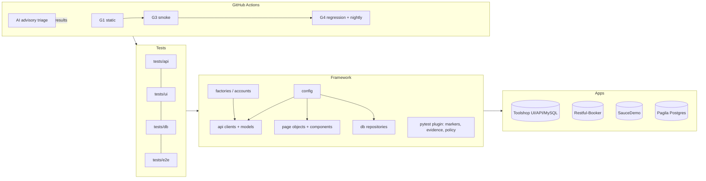

# P13: Capstone and Interview Readiness

> **Goal:** prove it end to end on a realistic product, turn your repo into interview stories, and rehearse full interview loops until they feel routine.
> **Apps:** Toolshop (normal and **with-bugs**), everything you've built. **Prerequisites:** P00–P12 (at least all 🟢 and 🔵 tasks). **Time:** ~36 h.

| ID | Task | Level | Time |
|---|---|---|---|
| P13-01 | Explain your framework: README, architecture and ADRs | 🔵 | 4h |
| P13-02 | Capstone: Toolshop end-to-end quality | 🟣 | 16h |
| P13-03 | Timed live-coding drills | 🔵 | 6h |
| P13-04 | Behavioural stories (STAR), resume and portfolio | 🔵 | 4h |
| P13-05 | Full mock interview loop | 🟣 | 6h |

---

### P13-01 · Explain your framework: README, architecture and ADRs

**Level:** 🔵 Hero · **Time:** 4h · **App:** your repo · **Deliverable:** `README.md`, `docs/architecture.md`, `docs/adr/0001-*.md` … `0003-*.md`

#### 📋 Task
1. Rewrite your `README.md`: what it tests and why, a one-command quick start, structure, running subsets (`-m`, `--env`), config and secrets, CI gates, reports and the AI tooling.
2. `docs/architecture.md` with a **Mermaid** diagram: tests → framework layers → apps, plus CI and AI components.
3. Write 3 **ADRs** (Architecture Decision Records): e.g. "pytest + Playwright (Python) over Selenium", "API-first hybrid tests", "AI checks are advisory".
4. Prepare two spoken versions of "walk me through your framework": **2 minutes** and **10 minutes**. Record both.

**Done when**
- [ ] A friend can run your smoke suite from the README alone
- [ ] Your 2-minute recording covers purpose, layers, one design decision and one measurable result

#### 📘 User guide

**Concepts**
- **Architecture communication:** show *layers and responsibilities*, not every file.
- **ADR:** a short record of a decision: context → decision → consequences (including trade-offs).
- **"Walk me through your framework":** the most common QE interview question at every level.

**Deep dive**

**The shape of a strong framework answer:**
1. **Purpose and scope:** "UI, API and DB tests for an e-commerce app, gated in CI."
2. **Layers:** config → clients/pages/DB repositories → fixtures/plugins → tests. Say *why* each exists.
3. **Key decisions and trade-offs:** hybrid API+UI, auth-state reuse, factories for parallel-safe data, and advisory AI, each with an alternative you rejected.
4. **Operations:** Docker, CI gates, reports, flaky policy.
5. **Results with numbers:** "the PR gate went from 22 to 7 minutes with xdist and sharding, and flake rate stayed under 1%."
6. **What you'd improve next:** this shows self-awareness.

**ADRs** prevent "why did we do this?" archaeology, and they're great interview material ("we chose X over Y because…").

**Examples**

🟢 **Low: a README skeleton**
```markdown
# qe-hero: UI, API and DB test automation for Toolshop, SauceDemo and Restful-Booker


## Quick start
make install && make smoke            # public demo apps, no setup
make stack-up && uv run pytest --env local -n auto

## What's inside
| Layer | Folder | Purpose |
|---|---|---|
| Config | framework/config.py | Typed settings from env |
| API clients | framework/api/ | Session, auth, retries, models |
| Page objects | framework/pages/ | Intent-level UI actions |
| DB | framework/db/ | Engines, read-only verification queries |
| Tests | tests/{api,ui,db,e2e} | Marked smoke/regression/… |

## CI gates · Reports · AI tooling · Contributing
…
```

🔵 **Medium: an architecture diagram (Mermaid)**
````markdown

````

🟣 **High/Complex: an ADR and the 2-minute answer**
```markdown
# ADR-0002: API-first hybrid UI tests

## Context
UI tests that create their own preconditions through the UI were slow (avg 38s) and flaky (3.1%),
and failures were hard to localise.

## Decision
UI tests create preconditions through API clients/factories and verify via UI; critical
flows additionally verify via API or DB. Login happens once per worker via storage_state.

## Consequences
+ UI suite 38s → 11s avg per test, flake rate 3.1% → 0.6% (measured over 30 nightly runs)
+ Failures localise to one layer
− Tests depend on API clients (maintenance), and UI-only regressions in setup screens need separate tests
```
**2-minute script:** *"I built a Python test framework for a full-stack e-commerce app (UI, REST API, MySQL). It's layered: typed config; API clients with pydantic models; page objects with components; and DB repositories for critical checks, all wired through pytest fixtures and a small plugin that enforces our policies. The key decision was API-first hybrid tests plus auth-state reuse, which cut UI test time by about 70% and brought flakiness under 1%. Everything runs in Docker, in parallel with xdist, sharded in GitHub Actions behind three gates, with traces and Allure reports on failure. On top of that I added an MCP server and a triage agent that classifies CI failures with 85% accuracy on my eval set, as an advisory tool. Next I'd add contract tests in the provider's pipeline."*

#### 🎤 Interview Q&A

<details><summary><b>[H] Walk me through your test automation framework.</b></summary>

Use the structure above: purpose → layers and why → 2–3 key decisions with trade-offs → how it runs (Docker, CI gates, parallelism, reporting) → measurable results → next improvements. Keep it at 2 minutes and offer to go deeper into any part. Have a diagram ready to share.
</details>

<details><summary><b>[H] Why did you choose these tools?</b></summary>

Tie each choice to requirements: Python for team skills and ecosystem; pytest for fixtures, plugins and parametrisation; Playwright for auto-waiting, tracing, multi-browser support and network control; requests for simplicity; Docker for reproducibility; GitHub Actions because the code lives on GitHub. Mention an alternative considered and why you rejected it (e.g. Selenium Grid: more infrastructure, more explicit waiting code).
</details>

<details><summary><b>[SH] What would you change in your framework if you started again?</b></summary>

Show reflection with specifics: e.g. contract tests earlier (schema drift cost us debugging time), per-worker accounts from day one (parallel collisions), stricter typing on page objects, a metrics store from the start for flake analysis, and skills or instruction files earlier so AI-assisted code followed conventions from the beginning.
</details>

<details><summary><b>[SH] How would you scale this framework to 10 teams?</b></summary>

Split a versioned core package (config, clients base, fixtures, plugin, reporting) from team-owned suites. Add templates and skills for consistent authoring, CODEOWNERS and contribution guidelines, shared CI reusable workflows, per-team dashboards (duration, flake rate), an internal support channel with office hours, and ADRs for cross-team decisions. Measure adoption and health rather than test counts.
</details>

<details><summary><b>[H] How do you onboard a new QE to your framework?</b></summary>

A one-command quick start (devcontainer), a README with an architecture diagram, a "first test" guided task (like this learning path), pairing on the first PR, conventions encoded in linters, plugins and skills, and a 30-day check-in. Measure time to first merged PR.
</details>

<details><summary><b>[Z] What is an ADR (architecture decision record)?</b></summary>

A short document that records one significant technical decision: the context, the decision itself, the options considered, and the consequences. ADRs are kept in the repo and numbered, so newcomers can understand *why* the framework is built the way it is, and later changes are made deliberately rather than by accident.
</details>

#### 🤖 AI assist
- Record your 2-minute pitch, transcribe it, and ask AI: *"As an interviewer, what follow-up questions would this raise, and where is it vague?"*

---

### P13-02 · Capstone: Toolshop end-to-end quality

**Level:** 🟣 Super Hero · **Time:** 16h · **App:** Toolshop (normal and with-bugs) · **Deliverable:** `capstone/strategy.md`, `capstone/test-plan.md`, tests under `tests/*/toolshop/`, `capstone/report.md`, a 15-minute demo

#### 📋 Task
Pick **one feature area** of Toolshop, e.g. *Cart → Checkout → Invoice*, *Search and filters*, or *Account and favourites*. Then:
1. **Risk-based strategy** (1–2 pages): risks ranked by impact × likelihood, the test-pyramid allocation for this feature, what you won't test and why.
2. **Test plan:** scope, approach per layer (API / UI / DB / contract / exploratory), environments, data, entry and exit criteria, and tooling.
3. **Implement:** API + UI + DB + E2E tests using your framework (factories, page objects, hybrid setup), parallel-safe, all markers set.
4. **At least one non-functional risk, tested properly (P11):** a performance budget for the feature's busiest endpoint, an accessibility gate on its key pages, or an authorisation matrix for its endpoints. Choose the one your risk ranking says matters most, and say why.
5. **Run the same suite against normal and with-bugs** (hosted, or locally via Toolshop's `SPRINT` setting), and compare the results.
6. **Pipeline:** gates green on the normal app, plus a nightly job against with-bugs whose failures go through your **AI triage** (P12-04). **You** verify every classification.
7. **Bug reports** for each real defect found (P10-01 template) with evidence.
8. **Final report:** a one-page executive summary plus metrics (P10-04), then a **15-minute demo**.

**Done when**
- [ ] Every risk rated "high" has at least one automated check at the right layer
- [ ] At least one non-functional risk (performance, accessibility or security) has an automated check with a stated threshold
- [ ] The with-bugs run produces bug reports, each human-verified, with the AI triage accuracy stated
- [ ] The demo is recorded (or presented to a peer or mentor)

#### 📘 User guide

**Concepts**
- **Risk-based testing:** effort follows risk (impact × likelihood), not feature count.
- **Test pyramid / trophy:** many fast low-level tests, fewer broad UI tests. Choose the *lowest* layer that can catch each risk.
- **Entry and exit criteria:** when testing can start (environment, data, builds) and when it's "done enough" (critical risks covered, no open P1 bugs, pass-rate thresholds).
- **Release readiness:** a decision informed by evidence and residual risk, not a vote on test counts.

**Deep dive**

**From risks to tests:** for each risk ask *what could go wrong*, *how bad would it be*, *how likely is it*, and *what is the cheapest reliable check that would catch it*. For example, "invoice total wrong" (high impact) → API test on totals, DB consistency check, and one UI E2E for display. "Button colour wrong" (low impact) → no automation.

**Two-environment comparison** is a powerful demo: the same suite goes green on the normal app and red on with-bugs, and each red is explained (a product bug found, or a test bug to fix). It proves your tests *detect* bugs, which is the real measure of a suite.

**AI triage as an assistant, not an oracle:** report its accuracy on the capstone failures and your corrections. That honesty is exactly what senior interviewers look for.

**Examples**

🟢 **Low: a risk register template**
| # | Risk | Impact (1–5) | Likelihood (1–5) | Score | Layer(s) | Test IDs |
|---|---|---|---|---|---|---|
| R1 | Invoice total ≠ sum of lines | 5 | 3 | 15 | API, DB, UI | `test_invoice_is_consistent_across_layers` |
| R2 | Customer sees another customer's invoice (IDOR) | 5 | 2 | 10 | API | `test_invoice_access_is_owner_only` |
| R3 | Checkout breaks when cart has 0 stock item | 4 | 3 | 12 | API, UI | … |
| R4 | Coupon applied twice | 4 | 2 | 8 | API | … |

🔵 **Medium: test plan outline and pyramid allocation**
```markdown
# Test plan: Cart → Checkout → Invoice
## Scope / out of scope
In: cart CRUD, checkout steps, payment method selection, invoice creation and listing.
Out: real payment gateways, email content (only "sent" is verified via MailCatcher), performance.
## Approach by layer
| Layer | Count | Focus |
|---|---|---|
| API | ~25 | business rules, validation, auth/IDOR, totals |
| DB | ~5 | persistence and consistency for money data |
| UI | ~6 | critical journeys, rendering of totals, error states (mocked) |
| E2E | 2 | full purchase happy path + failure path |
| Exploratory | 2 × 60 min | charters: "quantity edge cases", "session expiry mid-checkout" |
## Environments and data
Local Docker (sprint5, with-bugs) + hosted smoke; factories for users/carts; seeded catalogue.
## Entry / exit
Entry: stack healthy, seed OK. Exit: all R-scores ≥10 covered and green on normal; no open P1; flake rate < 1%.
```

🟣 **High/Complex: a two-environment comparison run and an executive summary**
```bash
# normal vs with-bugs: same suite, two result files (adapt the URLs/env profiles to your setup)
SUITE="tests/api/toolshop tests/ui/toolshop tests/db/toolshop tests/e2e"
uv run pytest $SUITE -m "not quarantine" -n 4 --env local \
  --junitxml=capstone/results-normal.xml
QE_TOOLSHOP_URL=https://with-bugs.practicesoftwaretesting.com \
QE_TOOLSHOP_API_URL=<with-bugs API host: find it in the app's network calls> \
  uv run pytest $SUITE -m "not quarantine and not db" -n 2 \
  --junitxml=capstone/results-with-bugs.xml
uv run python scripts/junit_summary.py capstone/results-with-bugs.xml "with-bugs" > capstone/with-bugs-summary.md
uv run python -m ai.agents.triage.cli capstone/results-with-bugs.xml --markdown > capstone/ai-triage.md
```
```markdown
# Capstone report: executive summary
**Feature:** Cart → Checkout → Invoice · **Verdict on with-bugs build:** ❌ not releasable

| | Normal | With-bugs |
|---|---|---|
| Tests run | 38 | 38 |
| Failed | 0 | 9 |
| Distinct product bugs | – | 4 (2 × P1) |

**Top risks found:** invoice total off by one line (P1), coupon applied twice (P1), …
**AI triage:** 9 failures → 8/9 classified correctly (1 env error misread as product bug; corrected).
**Coverage:** all 6 high risks automated (API 25, DB 5, UI 6, E2E 2) · PR gate 6m40s · flake rate 0%.
**Next:** contract tests in provider CI; add session-expiry charter findings as tests.
```

#### 🎤 Interview Q&A

<details><summary><b>[H] How do you create a test strategy for a new feature?</b></summary>

Understand the feature and its users, identify risks (business, technical, security, compliance) and rank them, choose the lowest effective test layer per risk, define environments and data, decide automated vs exploratory vs manual, set entry and exit criteria, plan CI integration and reporting, and review it with dev and product. Keep it living, and update it as risks change.
</details>

<details><summary><b>[H] You inherit 400 UI tests and 50 API tests (the basics are in P01-01 and P01-04). What do you do?</b></summary>

Treat it as an inverted pyramid and rebalance by risk rather than by rewriting everything. Map each UI test to the risk it covers; move checks of rules, validation and data to API or unit tests; keep a small set of UI journeys that prove the user's critical paths; delete duplicates; quarantine and fix flaky tests. Track suite duration, flake rate and escaped defects before and after, so the change is justified by numbers.
</details>

<details><summary><b>[SH] How do you present residual risk at a go/no-go meeting?</b></summary>

Start from the risk register, not test counts: for each high risk, say what was tested, at which layer, the result, and what remains uncovered or failing, with the likely impact and a mitigation (feature flag, monitoring, rollback plan, a fast follow-up fix). Give a recommendation, but make the decision the business owner's, with the trade-offs written down.
</details>

<details><summary><b>[H] What are entry and exit criteria? Give examples.</b></summary>

Entry: conditions to start testing meaningfully (build deployed, environment healthy, test data seeded, acceptance criteria available). Exit: conditions to stop or recommend release (all high risks covered and passing, no open P1/P2 defects without an agreed waiver, pass rate and flake thresholds met, exploratory charters done). They make "done" objective.
</details>

<details><summary><b>[SH] How do you make a go/no-go release recommendation?</b></summary>

Evidence-based: status of critical-flow checks, open defects by severity with workarounds, residual untested risks, trends (new failures, flakiness), non-functional results, and production-readiness items (monitoring, rollback). Present a clear recommendation with the risks the business is accepting. The decision belongs to stakeholders, and QA provides the clearest possible picture of risk.
</details>

#### 🤖 AI assist
- Use AI to **challenge your risk register** ("what risks am I missing for checkout?"). Keep only the risks you can justify, and cite the source (spec, similar incidents).

---

### P13-03 · Timed live-coding drills

**Level:** 🔵 Hero · **Time:** 6h · **App:** SauceDemo, Restful-Booker, Pagila · **Deliverable:** `interview-notes/drills/` (one folder per attempt, with time and score)

#### 📋 Task
From an **empty folder, no AI, timer on, talking out loud** (record at least 2):

| # | Drill | Time |
|---|---|---|
| D1 | Python: JSON diff with paths, **or** a log parser counting errors per module | 15 min |
| D2 | SauceDemo: POM (login, inventory, cart) + E2E test adding 2 items and verifying totals | 30 min |
| D3 | Restful-Booker: token fixture, CRUD test, 4-case negative matrix | 25 min |
| D4 | Pagila: 5 SQL questions (join, group by, anti-join, top-N per group, window) | 20 min |
| D5 | Dockerfile for the test runner + compose with a DB health check | 20 min |
| D6 | GitHub Actions workflow: static → smoke → gate, with artifacts | 20 min |

Score each with the rubric below. Redo your two weakest drills a week later and compare.

**Done when**
- [ ] All 6 drills attempted, scored and stored
- [ ] Your two weakest drills improved by at least 1 rubric point on the retry

#### 📘 User guide

**Concepts**
- **Live coding assesses:** problem-solving process, communication, code quality, testing mindset and speed, *in that order* at most companies.
- **Think aloud:** narrate intent, trade-offs and what you're checking.

**Deep dive**

**A routine that works for QE live coding:**
1. **Clarify (1–2 min):** which browser, what to assert, any constraints? State assumptions.
2. **Skeleton first:** a failing test that expresses the goal, then make it pass.
3. **Structure as you go:** extract a page object or client when you touch something a second time. Don't over-engineer at minute 3.
4. **Assertions that matter:** values, not just visibility. Mention negative cases even if there's no time to write them.
5. **Run often:** small steps, and read errors calmly.
6. **Wrap-up (last 3 min):** what you'd add with more time (negative tests, data factories, CI, parallelism).

**When stuck:** say what you're trying, try the simplest alternative, and ask a targeted question ("Is it OK if I look up the exact expect-API name?"). Interviewers reward calm debugging over memorised syntax.

**Examples**

🟢 **Low: a drill card**
```markdown
## D3 Restful-Booker, attempt 1 (2026-11-02)
Time: 27/25 min · Score: 3.2/5
Went well: token fixture, CRUD happy path
Missed: timeouts on requests; negative matrix only 2 cases; no cleanup on failure
Retry focus: factory fixture with cleanup; parametrized negatives
```

🔵 **Medium: a scoring rubric (1–5 each)**
| Dimension | 1 | 3 | 5 |
|---|---|---|---|
| Problem solving | Stuck, no plan | Plan, some detours | Clear plan, adapts smoothly |
| Communication | Silent | Explains sometimes | Narrates intent and trade-offs throughout |
| Code quality | Works barely, messy | Readable, some duplication | Clean structure, good names, no hard waits |
| Testing mindset | Happy path only | Some negatives mentioned | Meaningful asserts, negatives, data isolation |
| Completion | < 50% | Core done | Done, with extras explained |

🟣 **High/Complex: a think-aloud script for D3 (checkpoints)**
```text
00:00 "I'll clarify: auth via /auth token as cookie; assert status + body; clean up what I create. OK?"
02:00 "Skeleton: conftest with session http + base_url + token fixtures. Every call gets a timeout."
06:00 "First test: create → get → assert round trip. Running it… green."
10:00 "Refactor: a make_booking factory fixture that deletes created IDs at teardown, so tests stay independent."
15:00 "Negative matrix: no token, garbage token, unknown id, missing field; assert expected code AND < 500."
22:00 "Running all… one returns 500 for a missing field. I'd report that as a bug and mark it strict-xfail."
24:00 "With more time: pydantic models, client layer, parallel-safe data, CI job."
```

#### 🎤 Interview Q&A

<details><summary><b>[Z] What do interviewers look for in a QE live-coding round?</b></summary>

Structured problem solving, clear communication, clean and maintainable code, a testing mindset (meaningful assertions, negative cases, data isolation, no hard waits), and calm debugging. Finishing matters less than showing how you think and what you'd do next.
</details>

<details><summary><b>[H] You get stuck during live coding. What do you do?</b></summary>

Say where you're stuck and what you've tried, simplify (hard-code first, generalise later), use a quick experiment (print, run a smaller piece), and ask a precise question if an API detail is blocking. Keep moving: a partial solution with good reasoning beats silence.
</details>

<details><summary><b>[H] You don't remember an exact library API. Is that OK?</b></summary>

Usually yes. Say what you need ("the expect assertion for exact text; I believe it's `to_have_text`"), write it, and verify by running. Ask if docs are allowed. Interviewers care about knowing *what* to use and *why* much more than perfect recall.
</details>

<details><summary><b>[SH] The interviewer changes the requirements halfway through. How do you respond?</b></summary>

Acknowledge it, restate the new requirement and its impact, adjust the plan out loud (what stays, what changes), and refactor incrementally with tests green. It mirrors real work, and they're testing adaptability and how well your structure absorbs change, which is where a good POM or client layer pays off.
</details>

#### 🤖 AI assist
- *After* each drill (never during), paste your solution and ask AI to review it as a strict interviewer against the rubric. Compare its score with your self-score.

---

### P13-04 · Behavioural stories (STAR), resume and portfolio

**Level:** 🔵 Hero · **Time:** 4h · **App:** your repo · **Deliverable:** `interview-notes/stories.md`, `docs/portfolio.md`, updated resume bullets

#### 📋 Task
1. Write **8 STAR stories** from this journey (or your real job): a bug you're proud of finding, a flaky test you fixed, a speed-up you delivered, a disagreement with a developer, prioritising under a deadline, a process improvement (CI gates), AI adoption, and a mistake and what you learned.
2. Quantify every result with numbers from your repo (durations, flake rates, bug counts, eval accuracy).
3. Write **5–7 resume bullets** using the "action + scope + measurable result" format, and map them to a real job description.
4. `docs/portfolio.md`: a pinned-repo summary with links to reports, the dashboard, a demo video and ADRs.
5. Rehearse "Tell me about yourself" in 90 seconds.

**Done when**
- [ ] 8 stories, each ≤ 2 minutes spoken, each with a number in the Result
- [ ] Resume bullets mapped to at least one real job description

#### 📘 User guide

**Concepts**
- **STAR:** Situation, Task, Action (the biggest part, and about *you*), Result (numbers plus learning).
- **Quantification:** time, percentage, count, cost, risk reduced.
- **Honest framing:** portfolio work is legitimate. Present it as "in my practice project, I…" rather than implying employment.

**Deep dive**

**Great behavioural answers are specific.** "I usually communicate well" is weak. "When the dev said the invoice bug was 'expected behaviour', I showed the API vs DB vs UI totals side by side and the spec line, and we fixed it the same day" is strong. Specifics carry credibility.

**Resume bullets that get interviews** show *impact*, not *duties*. Most automation resumes list tools. Stand out with outcomes and scale.

**Examples**

🟢 **Low: a STAR template**
```markdown
### Story: <title>
- **S**ituation (1–2 sentences):
- **T**ask (my responsibility):
- **A**ction (3–5 concrete steps I took; "I", not "we"):
- **R**esult (numbers + what I learned / would do differently):
- Fits questions: "a time you improved a process", "…"
```

🔵 **Medium: a full story**
```markdown
### Story: Flaky suite → trusted gate
- S: My UI smoke gate failed ~1 in 6 runs; people re-ran instead of reading failures.
- T: Make the gate trustworthy without slowing it down.
- A: Measured per-test flake rates from 30 CI runs (SQL on JUnit history); found 3 root causes:
     shared customer account across workers, a hard wait, and racing a re-render.
     Introduced per-worker accounts, replaced waits with expect/expect_response,
     and added a quarantine policy with a 14-day SLA enforced in CI.
- R: Flake rate 4.8% → 0.4%; gate re-runs dropped to near zero; a real race-condition bug
     was found in the process. Learned: investigate flakiness before retrying.
```

🟣 **High/Complex: resume bullets before and after, mapped to a job description**
| ❌ Before | ✅ After |
|---|---|
| "Wrote Playwright tests" | "Built a Python Playwright + pytest framework (POM, API-first hybrid setup, auth-state reuse) covering 38 critical e-commerce scenarios; UI test time −70%" |
| "Used Docker and GitHub Actions" | "Containerised the test stack (Compose with health checks) and designed 3 CI gates with sharding: PR feedback 22 → 7 min, 0.4% flake rate" |
| "Worked with AI tools" | "Built an MCP server and a failure-triage agent with an evaluation set (85% accuracy), delivered as an advisory CI check with read-only guardrails" |

| JD requirement | My evidence |
|---|---|
| "Python automation for API and UI" | P04, P05 framework; capstone |
| "CI/CD experience" | P09 gates, nightly with Pages report |
| "Database testing" | P06 API→DB consistency, integrity rules |
| "Interest in AI for testing" | P12 MCP server, skills, triage agent with evals |

#### 🎤 Interview Q&A

<details><summary><b>[Z] Tell me about yourself.</b></summary>

90 seconds: present (role and focus: "QE specialising in Python UI/API automation and CI"), a highlight with numbers (the framework or capstone result), what you enjoy (quality at scale, pragmatic AI), and why this role fits. Tailor the highlight to the job description. No life story.
</details>

<details><summary><b>[H] Tell me about a disagreement with a developer.</b></summary>

STAR, focused on evidence and collaboration. For example: a bug dismissed as "expected". I reproduced it minimally, showed the spec and the three-layer evidence, proposed the fix scope and impact, and we agreed. The result was fixed before release, plus a new contract test. Show respect, data and a shared goal, never "I was right".
</details>

<details><summary><b>[H] Tell me about a bug you're proud of finding.</b></summary>

Pick one with real impact and interesting detection: e.g. an IDOR in the invoice API found with a two-user test, or a rounding mismatch found by comparing API, DB and UI. Explain how you thought to look there (risk analysis), how you proved it, the impact, and what prevention you added afterwards.
</details>

<details><summary><b>[H] Tell me about a mistake you made.</b></summary>

A real, moderate mistake: e.g. adding blanket retries that hid a real race condition. Own it, explain how it was discovered, what you fixed, and the systemic change (a quarantine policy, and flakiness investigated before retrying). Growth is the point.
</details>

<details><summary><b>[SH] Management wants to release with a known high-severity bug. What do you do?</b></summary>

Make the risk explicit and quantified (who's affected, likelihood, workaround, blast radius), propose options (fix-forward timeline, a feature flag to disable the path, a partial rollout, extra monitoring), document the decision and its owner, and make sure support and monitoring are ready. QA informs the decision with evidence. The accountable stakeholders decide.
</details>

<details><summary><b>[Z] What is the STAR method?</b></summary>

A structure for behavioural answers: **S**ituation (the context, briefly), **T**ask (what you were responsible for), **A**ction (what *you* did, the longest part) and **R**esult (the outcome, with a number if possible, plus what you learned). It keeps answers focused, specific and about your own contribution.
</details>

#### 🤖 AI assist
- Ask AI to act as a behavioural interviewer and push with follow-ups ("what exactly did *you* do?", "what would you do differently?"). Tighten each story.

---

### P13-05 · Full mock interview loop

**Level:** 🟣 Super Hero · **Time:** 6h · **App:** — · **Deliverable:** `interview-notes/mock-loop.md` (scores, feedback and an improvement plan for 2 loops)

#### 📋 Task
Run a complete loop with a peer, a mentor or an AI interviewer. Then repeat it 2 weeks later.

| Round | Length | Content |
|---|---|---|
| R1 Screen | 30 min | Tell-me-about-yourself, fundamentals from P00–P06 |
| R2 Coding | 60 min | D1 + D3 style (Python + API) |
| R3 UI automation | 60 min | D2 style plus a debugging scenario |
| R4 Design | 45 min | One system-design prompt (below) |
| R5 Data and infra | 45 min | SQL + Docker + CI questions |
| R6 AI | 30 min | P12 topics plus the "AI auto-fixing tests" scenario |
| R7 Behavioural | 30 min | 4 STAR stories |

**Design prompts (pick one per loop):**
1. Design the test strategy and automation for an e-commerce platform with 12 microservices, web and mobile, releasing daily.
2. How would you test a new **payments** feature end to end?
3. Design CI quality gates for a monorepo with 40 engineers.
4. Design a test-data platform for parallel testing across 5 teams.
5. You're the new QE lead: how do you introduce AI into a 30-person QA organisation?

**Done when**
- [ ] 2 full loops scored, with the second loop improving by at least 0.5 average
- [ ] A written improvement plan with dates for your 3 weakest areas

#### 📘 User guide

**Concepts**
- **Loop:** multiple focused rounds, each assessing different competencies.
- **System-design (QE flavour):** strategy, architecture of testing, environments and data, CI/CD, observability, metrics and roadmap, plus the trade-offs.

**Deep dive**

**A framework for QE design questions (say it explicitly):**
1. **Clarify:** users, scale, release cadence, critical flows, constraints (compliance, budget), current state.
2. **Risks:** what hurts most if broken (money, security, data, availability).
3. **Strategy per layer:** unit (dev-owned), contract, API/service, UI/E2E (few, critical), non-functional (performance, security, accessibility), exploratory.
4. **Environments and data:** ephemeral environments, service virtualisation, factories, masking.
5. **CI/CD gates:** what runs where, time budgets, flaky policy, release criteria.
6. **Observability and production:** synthetic monitoring, feature flags, canary releases, alerting, feedback loop from incidents.
7. **People and process:** ownership (you build it, you test it), enablement, standards.
8. **Metrics and roadmap:** how you'll know it works, and phases for the first 30/60/90 days.
9. **Trade-offs:** name what you're *not* doing and why.

**Examples**

🟢 **Low: a loop schedule and log**
```markdown
| Round | Date | Interviewer | Score | Top feedback |
|---|---|---|---|---|
| R1 | 11-10 | AI | 3.8 | Rambling intro; cut to 90s |
| R2 | 11-10 | Peer (Sam) | 3.2 | Forgot timeouts; good fixtures |
```

🔵 **Medium: a design-round rubric (1–5)**
| Dimension | What 5 looks like |
|---|---|
| Clarification | Asks about scale, cadence, risks, constraints before designing |
| Risk focus | Strategy clearly driven by ranked risks |
| Layering | Right checks at the right layers, a pyramid-aware justification |
| Operability | Environments, data, CI gates, flakiness, observability all addressed |
| Trade-offs | Explicit about costs, what's excluded and why |
| Communication | Structured, diagrams, checks understanding |

🟣 **High/Complex: a model answer outline for prompt 1 (12 microservices, daily releases)**
```text
Clarify: web+mobile, 12 services (catalog, cart, checkout, payments, users…), daily deploys per service,
         PCI scope for payments, ~40 devs, current pain = slow E2E suite & escaped integration bugs.
Risks:   checkout/payment correctness, auth/IDOR, inter-service contract breaks, data consistency, peak load.
Layers:  - Unit + component tests owned by service teams (gated in each service's CI)
         - Consumer-driven contracts (Pact) between services + OpenAPI diff gates for breaking changes
         - Service-level API tests per service with virtualised dependencies (fast, per PR)
         - A thin E2E layer: ~20 critical journeys (web) + ~10 (mobile), run post-deploy in staging & nightly
         - Non-functional: load tests for checkout before peak events; security (DAST, dependency scanning); a11y
Envs:    ephemeral per-PR env for the changed service + stubs; shared staging for E2E; synthetic data factories;
         masked prod-like snapshots for migration tests
CI/CD:   per-service gates (unit, contract, API) < 10 min; post-deploy smoke + canary analysis; automated rollback
Prod:    synthetic monitoring of critical journeys, feature flags, SLO-based alerting, incident → test feedback loop
Metrics: change failure rate, escaped defects by layer, gate duration, flake rate, contract coverage
Roadmap: 30d contracts for checkout/payments + flaky clean-up; 60d ephemeral envs; 90d E2E reduced to critical set
Trade-offs: fewer E2E tests (accept some integration risk, mitigated by contracts + canaries)
```

#### 🎤 Interview Q&A

<details><summary><b>[SH] How would you test a new payments feature end to end?</b></summary>

Clarify flows (card, wallet, refunds, partial captures), compliance (PCI) and providers. Then: unit and API tests for amounts, currency rounding, idempotency keys (no double charges), state transitions (authorised → captured → refunded), and error handling (declines, timeouts, 3-D Secure). Provider sandbox and virtualised responses for failures. Contract tests with the provider SDK or API. DB and ledger reconciliation. Security (no card data in logs, tokenisation, authorisation). Concurrency (double-click, retries). A few E2E journeys. Monitoring and reconciliation jobs in production. Feature-flagged rollout.
</details>

<details><summary><b>[H] How do you decide what NOT to automate?</b></summary>

Low-risk or rarely used areas, one-off or rapidly changing UIs (automate after they stabilise), checks that are cheaper as exploratory or manual (visual feel, usability), things better caught at a lower layer (don't UI-test validation rules covered by API tests), and tests whose maintenance cost exceeds the risk they cover. Revisit as risk changes.
</details>

<details><summary><b>[H] How would you test a feature with no written requirements?</b></summary>

Gather implicit requirements: talk to product and devs, look at similar features, competitors, support tickets and the code. Explore with charters, document the observed behaviour and questions, confirm expectations with stakeholders, then automate the *agreed* behaviour. Push for acceptance criteria going forward, and use the gaps as risk items.
</details>

<details><summary><b>[H] How would you test a search feature?</b></summary>

Relevance (expected top results for key queries, a golden set), correctness of filters, sorting and pagination (invariants), edge inputs (empty, special characters, unicode, very long, injection), typo tolerance and synonyms if specified, performance (latency percentiles under load), index freshness after data changes, access control (no hidden items leaking), and analytics events. Combine API-level automation with exploratory relevance reviews.
</details>

<details><summary><b>[SH] What would your first 90 days as a QE lead look like?</b></summary>

Days 1–30: listen and measure: meet teams, map the release process, gather metrics (escaped defects, gate duration, flake rate), identify top risks and pains. Quick wins: fix the flakiest tests, stabilise the PR gate. Days 31–60: publish a test strategy and roadmap, introduce standards (framework conventions, quarantine policy), pilot contract tests or AI triage in one team. Days 61–90: scale what worked, set up dashboards, run training, and report results against the baseline. Throughout, build trust with dev and product.
</details>

<details><summary><b>[SH] Leadership wants AI to auto-fix failing tests in CI. Your response?</b></summary>

Support the goal (less toil), but redirect the design: auto-fixing can hide real product bugs (a "fixed" assertion that now accepts the bug), so start with advisory triage and *suggested* fixes as PRs for test-side issues only (locators, test data), with human review, eval data on suggestion quality, and never touching assertions or expected values automatically. Measure precision, and expand scope only with evidence.
</details>

<details><summary><b>[Z] What should you ask the interviewer at the end of a QE interview?</b></summary>

Questions that show how you think about quality and help you decide: how testing is organised (a separate QA team or embedded QEs), how releases and quality gates work, what the biggest quality pain is right now, how flaky tests and escaped bugs are handled, and what success would look like in the first 90 days. Avoid questions the job advert already answers.
</details>

#### 🤖 AI assist
- Use the phase-checkpoint prompts from P00–P12 as rounds. For the design round, ask AI to be a *staff-level interviewer who challenges trade-offs*. Then do at least one loop with a **human**: AI can't fully judge presence and communication.

---

## 🏁 Final checkpoint: you're a Super Hero when…

- [ ] Your repo runs green from a fresh clone in one command (Docker/devcontainer), in parallel, behind CI gates
- [ ] You can explain every file you wrote, and every design decision has a trade-off you can name
- [ ] Your capstone found real bugs, and your suite *proved* it can detect them
- [ ] You've built (not just used) an MCP server, skills and an evaluated agent, with guardrails
- [ ] You've taught one topic to someone else (a session, blog post or recorded walkthrough)
- [ ] Two full mock loops are done, and your weakest area has a plan

Record your final reflection in `interview-notes/P13.md`: what you'd tell yourself at P00.
